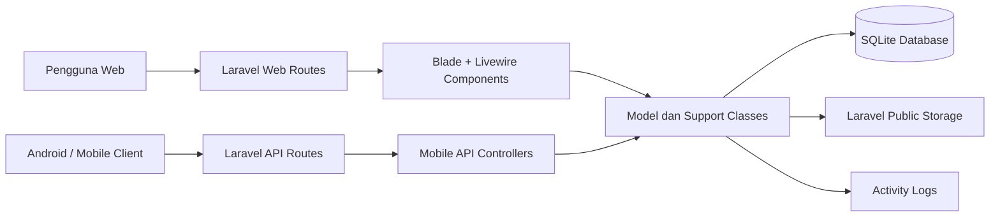

# Laporan Utama Pengembangan Aplikasi E-Surat

## Identitas Dokumen

Nama aplikasi: E-Surat  
Jenis sistem: Sistem informasi manajemen surat dan arsip digital  
Platform: Web dan API mobile  
Tanggal penyusunan: 14 Oktober 2026  
Repository lokal: `D:\App\E-Surat`

## Ringkasan Eksekutif

Aplikasi E-Surat dikembangkan untuk mendigitalisasi pengelolaan surat masuk, surat keluar, disposisi, arsip, penomoran surat, dan penomoran Surat Keputusan (SK). Sistem ini menggantikan proses manual berbasis kertas dengan proses digital yang lebih mudah dilacak, terdokumentasi, dan dapat diakses sesuai hak pengguna.

Implementasi saat ini menggunakan Laravel sebagai backend utama, Livewire dan Blade untuk antarmuka web interaktif, Sanctum untuk autentikasi API mobile, serta SQLite sebagai database operasional yang ringan. Sistem sudah memiliki modul inti untuk login, dashboard, pelacakan surat, tugas pengguna, halaman pimpinan, halaman kepala bagian, pengaturan master data, monitoring nomor surat, penomoran SK, unggah dokumen, export CSV, dan akses dokumen berdasarkan role.

## Latar Belakang

Pengelolaan surat secara manual memiliki beberapa kendala umum:

- Pencarian arsip membutuhkan waktu lama.
- Risiko kehilangan dokumen fisik cukup tinggi.
- Proses disposisi bergantung pada distribusi manual.
- Monitoring status surat sulit dilakukan secara real-time.
- Penomoran surat rawan duplikasi atau terlewat.
- Bukti aktivitas administrasi sulit diaudit secara lengkap.

Aplikasi E-Surat menjawab kebutuhan tersebut dengan menyimpan data surat dan dokumen digital dalam satu sistem, menyediakan alur disposisi elektronik, mengatur akses berdasarkan role, serta mencatat aktivitas penting ke log sistem.

## Tujuan Pengembangan

Tujuan utama pengembangan aplikasi adalah:

- Menyediakan sistem digital untuk pencatatan surat masuk dan surat keluar.
- Memudahkan pimpinan dalam memberikan disposisi kepada unit atau staf terkait.
- Memudahkan kepala bagian dan staf memantau tugas serta memperbarui status tindak lanjut.
- Menyediakan mekanisme penomoran surat dan SK yang tertib.
- Menyimpan file dokumen, lampiran, dan scan disposisi secara terstruktur.
- Menyediakan API mobile agar proses administrasi dapat diakses dari aplikasi Android.
- Meningkatkan akuntabilitas melalui log aktivitas dan pembatasan akses.

## Ruang Lingkup

Ruang lingkup pengembangan yang tercakup dalam sistem:

- Autentikasi pengguna web dan API mobile.
- Manajemen role pengguna.
- Dashboard surat masuk dan keluar.
- Pencatatan surat masuk.
- Pembuatan surat keluar dengan template isi surat.
- Unggah dokumen surat dan lampiran.
- Disposisi surat masuk dari pimpinan atau sekretaris pribadi.
- Disposisi mandiri tanpa relasi surat.
- Penerusan disposisi dari kepala bagian kepada penerima lanjutan.
- Sinkronisasi status surat berdasarkan status disposisi.
- Pelacakan surat dan daftar tugas pengguna.
- Monitoring nomor surat keluar.
- Pencatatan nomor SK beserta file pendukung.
- Manajemen kode klasifikasi arsip.
- Export daftar surat ke CSV.
- Endpoint API mobile untuk dashboard, surat, dokumen, disposisi, approval, penomoran, referensi, dan versi aplikasi.

## Pengguna dan Role

Sistem mengenali beberapa role utama:

- Admin Sekretariat: mengelola sistem, data pengguna, setting, surat, nomor, arsip, dan dokumen.
- Pimpinan MRP: melihat surat yang memerlukan tindakan pimpinan dan membuat disposisi.
- Sekretaris Pribadi: membantu input disposisi pimpinan, termasuk unggah scan disposisi.
- Kepala Bagian: menerima disposisi, memperbarui status, dan meneruskan disposisi kepada penerima lain.
- Staf Sekretariat: mengakses dashboard, tugas, dan dokumen sesuai kewenangan.

## Modul Aplikasi

### Dashboard

Dashboard menyajikan ringkasan surat, daftar surat, filter pencarian, status, prioritas, tenggat, dan akses ke dokumen terkait. Dashboard menjadi halaman kerja utama setelah pengguna login.

### Surat Masuk dan Surat Keluar

Sistem menyimpan data surat dengan atribut utama seperti jenis surat, unit, nomor, nomor agenda, kode klasifikasi, perihal, pihak eksternal, tanggal surat, tanggal diterima, sifat, prioritas, tenggat, lokasi arsip, retensi, file dokumen, dan status.

### Disposisi Elektronik

Disposisi dapat dibuat untuk surat masuk atau sebagai disposisi mandiri. Disposisi menyimpan pengirim, penerima, instruksi, status, metode input, identitas penginput, file scan, dan relasi disposisi induk untuk alur penerusan.

### Penomoran Surat

Sistem menyediakan generator nomor surat keluar dan nomor agenda surat masuk. Format nomor dapat memakai kode klasifikasi, nomor urut, kode unit, bulan, dan tahun sesuai pengaturan.

### Penomoran SK

Modul penomoran SK mencatat nomor, unit, kode klasifikasi, urutan, tahun, judul, tanggal keputusan, status, catatan, file SK, dan pembuat catatan.

### Arsip dan Klasifikasi

Klasifikasi arsip disimpan sebagai master data dengan kode, nama, kode induk, dan deskripsi. Surat dapat dikaitkan dengan kode klasifikasi untuk memudahkan penataan arsip.

### API Mobile

API mobile disediakan melalui prefix `/api/mobile`. Autentikasi menggunakan token Bearer dari Laravel Sanctum. Endpoint mencakup login, profil pengguna, dashboard, referensi, penomoran, SK, surat, dokumen, disposisi, dan approval.

## Arsitektur Sistem

Aplikasi memakai pola monolitik Laravel:

- Laravel menangani routing, autentikasi, model, validasi, storage, dan response API.
- Blade dan Livewire menangani antarmuka web interaktif.
- Sanctum menangani token API mobile.
- SQLite digunakan sebagai database lokal.
- File dokumen disimpan pada disk `public` Laravel.
- Vite dan TailwindCSS digunakan untuk build asset frontend.

## Hasil Pengembangan

Hasil yang telah tersedia dalam repository:

- Struktur Laravel lengkap dengan konfigurasi Composer, NPM, Vite, database, route, controller, model, migration, seeder, view, dan test.
- Halaman web: login, dashboard, monitoring nomor, penomoran SK, tracking surat, tugas saya, pimpinan, kepala bagian, settings, review/download dokumen, export CSV, dan template surat keluar.
- API mobile dengan endpoint autentikasi, dashboard, referensi, surat, dokumen, disposisi, approval, penomoran, SK, dan versi aplikasi.
- Model data utama: User, Letter, Disposition, DispositionRecipient, ArchiveClassification, LetterAttachment, LetterApproval, DecisionLetterNumber, AppSetting, dan ActivityLog.
- Support class untuk akses dokumen, format API mobile, penomoran surat, inbox tugas, dan export DOCX surat keluar.
- Test suite feature yang mencakup login, role access, mobile API, disposisi, penomoran, upload file, settings, tugas pengguna, approval, dan status surat.

## Risiko dan Mitigasi

| Risiko | Dampak | Mitigasi |
| --- | --- | --- |
| Database SQLite tidak cocok untuk beban multi-instansi besar | Performa menurun saat data dan akses sangat tinggi | Migrasi ke MySQL/PostgreSQL jika skala pengguna bertambah |
| File dokumen hilang karena backup tidak rutin | Kehilangan arsip digital | Terapkan backup harian database dan storage |
| Hak akses berubah tanpa prosedur | Data dapat diakses role yang tidak tepat | Audit role dan activity log secara berkala |
| Test belum mencakup semua edge case produksi | Bug muncul pada skenario tertentu | Tambah test regresi untuk kasus produksi |
| API mobile bergantung pada token aktif | Risiko akses jika perangkat hilang | Sediakan revoke token dan kebijakan logout perangkat |

## Rekomendasi

- Menyusun SOP penggunaan harian untuk Admin, Pimpinan, Kepala Bagian, dan Staf.
- Menambahkan dokumentasi API rinci dengan contoh request dan response.
- Menyiapkan backup otomatis database dan storage dokumen.
- Menambahkan monitoring error dan audit log berbasis dashboard.
- Menyiapkan staging environment sebelum perubahan dirilis ke produksi.
- Menambah test untuk otorisasi dokumen, validasi upload, dan workflow approval penuh.

## Kesimpulan

Aplikasi E-Surat telah memiliki fondasi teknis dan fungsional yang memadai untuk mendukung digitalisasi tata naskah surat pada skala instansi tunggal. Sistem sudah mencakup pencatatan surat, disposisi, pelacakan, arsip, penomoran, akses dokumen, API mobile, serta pengujian otomatis. Tahap berikutnya yang disarankan adalah memperkuat dokumentasi operasional, backup, observability, dan pengujian regresi sebelum digunakan sebagai sistem produksi jangka panjang.

