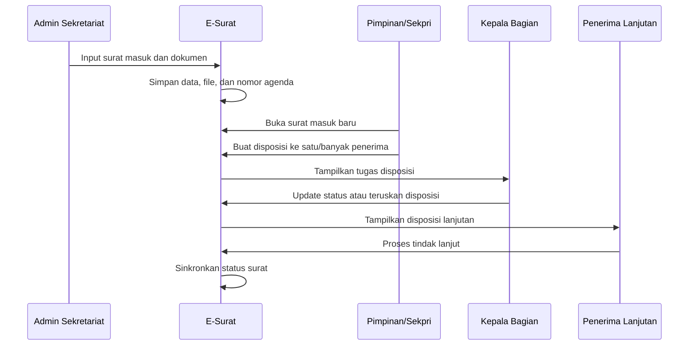
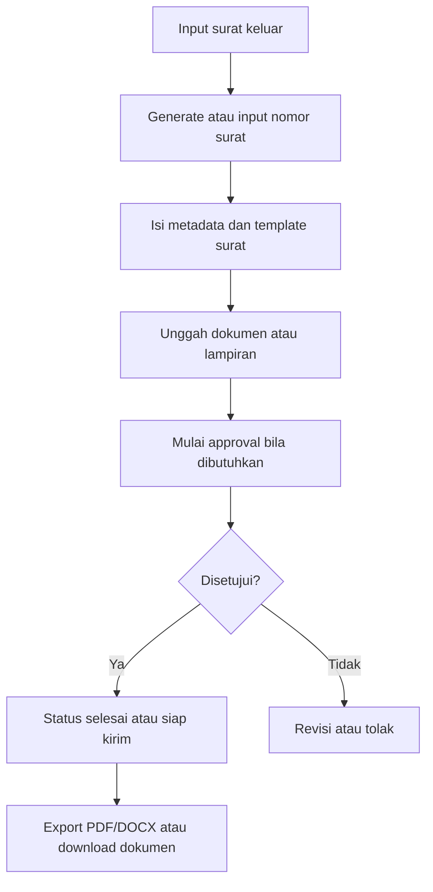

# Desain Teknis Aplikasi E-Surat

## Stack Teknologi

| Lapisan | Teknologi |
| --- | --- |
| Backend | PHP 8.3, Laravel 13 |
| Frontend web | Blade, Livewire 4, TailwindCSS 4 |
| API mobile | Laravel API routes, Laravel Sanctum |
| Database | SQLite |
| Asset build | Vite 8 |
| Testing | PHPUnit 12, Laravel Feature Test, Livewire Test |
| Storage | Laravel filesystem disk `public` |

## Struktur Utama Repository

| Path | Fungsi |
| --- | --- |
| `app/Models` | Model Eloquent untuk entitas utama |
| `app/Http/Controllers/Api/Mobile` | Controller API mobile |
| `app/Support` | Logic pendukung seperti penomoran, akses dokumen, inbox, dan formatter |
| `database/migrations` | Definisi struktur database |
| `database/seeders` | Data awal pengguna, surat, klasifikasi, setting, dan penerima disposisi |
| `resources/views` | View Blade dan komponen Livewire |
| `routes/web.php` | Endpoint web |
| `routes/api.php` | Endpoint API mobile |
| `tests/Feature` | Test fungsional aplikasi |

## Modul Domain

### Letter

Model `Letter` merepresentasikan surat masuk dan surat keluar. Relasi utama:

- `dispositions`: satu surat dapat memiliki banyak disposisi.
- `attachments`: satu surat dapat memiliki banyak lampiran.
- `approvals`: satu surat dapat memiliki banyak approval.
- `classification`: surat terhubung ke kode klasifikasi arsip.

Logic penting:

- `canReceiveDisposition()` membatasi disposisi hanya untuk surat masuk.
- `syncDispositionStatus()` menyinkronkan status surat berdasarkan status semua disposisi.
- `scopeApplyDashboardFilters()` menangani filter dashboard dan export CSV.

### Disposition

Model `Disposition` menyimpan alur instruksi disposisi. Relasi utama:

- `letter`: disposisi dapat terkait surat atau null untuk disposisi mandiri.
- `recipient`: terhubung ke master penerima disposisi.
- `parent` dan `children`: mendukung penerusan disposisi bertingkat.

### User

Model `User` menggunakan Laravel authentication dan Sanctum token. Role dikenali melalui helper:

- `isAdmin()`
- `isLeader()`
- `isPersonalSecretary()`
- `isStaff()`
- `isDepartmentHead()`

### DecisionLetterNumber

Model ini menyimpan nomor SK beserta file pendukung. Unik pada kombinasi unit, tahun, dan nomor urut.

## Kontrol Akses

Kontrol akses diterapkan pada route dan support class.

### Route Web

- Semua halaman utama dilindungi middleware `auth`.
- Halaman monitoring nomor, penomoran SK, dan settings dibatasi untuk admin.
- Halaman pimpinan dapat dibuka admin, pimpinan, dan sekretaris pribadi.
- Halaman kepala bagian dapat dibuka admin dan kepala bagian.

### Akses Dokumen

`App\Support\DocumentAccess` mengatur izin baca dokumen:

- Admin, staf, pimpinan, dan sekretaris pribadi dapat melihat dokumen surat.
- Kepala bagian dapat melihat dokumen jika namanya terlibat sebagai pengirim atau penerima disposisi.
- Akses lampiran mengikuti akses surat.
- Akses scan disposisi untuk kepala bagian mengikuti keterlibatan langsung atau relasi parent-child disposisi.

## Alur Proses Surat Masuk

## Alur Proses Surat Keluar

## Penomoran

Class `LetterNumbering` menyediakan:

- `nextLetterNumber()` untuk nomor surat keluar.
- `nextAgendaNumber()` untuk nomor agenda surat masuk.
- `advanceNextLetterSequence()` untuk memajukan sequence setelah nomor digunakan.
- `monitor()` untuk melihat nomor terpakai, nomor kosong, rentang kosong, dan rekomendasi nomor.

Format default menggunakan:

- Prefix atau kode klasifikasi.
- Sequence 3 digit.
- Kode unit.
- Bulan jika aktif.
- Tahun jika aktif.
- Separator dari setting.

## Logging Aktivitas

Aktivitas penting dicatat ke tabel `activity_logs`, termasuk review/download dokumen, export CSV, download template klasifikasi, akses file SK, dan export template surat keluar.

## Pertimbangan Skalabilitas

Arsitektur monolitik Laravel cocok untuk skala instansi tunggal. Jika kebutuhan berkembang, peningkatan yang disarankan:

- Migrasi SQLite ke PostgreSQL atau MySQL.
- Pisahkan storage dokumen ke object storage.
- Tambahkan queue worker permanen untuk pekerjaan berat.
- Tambahkan cache untuk dashboard dan referensi yang jarang berubah.
- Tambahkan monitoring error aplikasi.

