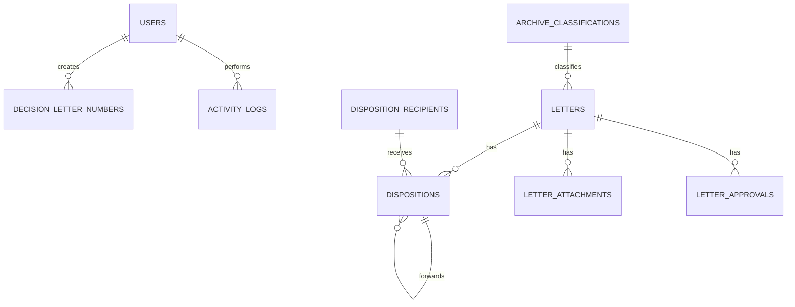

# Database dan API Aplikasi E-Surat

## Ringkasan Database

Database menggunakan migration Laravel. Tabel utama:

| Tabel | Fungsi |
| --- | --- |
| `users` | Data akun pengguna dan role |
| `letters` | Data utama surat masuk dan keluar |
| `dispositions` | Instruksi disposisi dan penerusan |
| `disposition_recipients` | Master penerima disposisi |
| `archive_classifications` | Master kode klasifikasi arsip |
| `letter_attachments` | Lampiran surat |
| `letter_approvals` | Alur persetujuan surat |
| `decision_letter_numbers` | Nomor Surat Keputusan |
| `app_settings` | Setting aplikasi berbasis key-value |
| `activity_logs` | Log aktivitas pengguna dan sistem |
| `personal_access_tokens` | Token API Laravel Sanctum |

## Entitas dan Field Penting

### `letters`

Field penting:

- `type`: `Masuk` atau `Keluar`.
- `outgoing_input_mode`: mode input surat keluar.
- `unit_code`: kode unit.
- `classification_code`: kode klasifikasi arsip.
- `agenda_number`: nomor agenda surat masuk.
- `number`: nomor surat, unik.
- `subject`: perihal.
- `outgoing_body`: isi template surat keluar.
- `signer_name`, `signer_title`: data penanda tangan.
- `external_party`: pengirim atau penerima eksternal.
- `letter_date`, `received_date`: tanggal surat dan tanggal diterima.
- `nature`, `urgency`, `due_date`: sifat, prioritas, dan tenggat.
- `archive_location`, `archive_box`, `retention_category`, `retention_until`, `archive_notes`: metadata arsip.
- `file_path`: path dokumen utama.
- `status`: status proses surat.

### `dispositions`

Field penting:

- `letter_id`: relasi ke surat, nullable untuk disposisi mandiri.
- `parent_id`: relasi ke disposisi induk.
- `sender_name`: nama pengirim disposisi.
- `recipient_name`: nama penerima disposisi.
- `disposition_recipient_id`: relasi ke master penerima.
- `instruction`: instruksi disposisi.
- `status`: `Belum Dibaca`, `Diproses`, atau `Selesai`.
- `input_method`: contoh `Elektronik` atau `Upload File Disposisi`.
- `input_by_name`, `input_by_role`: identitas penginput.
- `scan_path`, `scan_original_name`, `scan_mime_type`, `scan_size`: metadata scan disposisi.

### `decision_letter_numbers`

Field penting:

- `unit_code`
- `classification_code`
- `sequence`
- `year`
- `number`
- `title`
- `decision_date`
- `status`
- `notes`
- `file_path`
- `created_by`

Constraint penting:

- `number` unik.
- Kombinasi `unit_code`, `year`, dan `sequence` unik.

## Relasi Data

## Endpoint Web

| Method | Path | Fungsi | Akses |
| --- | --- | --- | --- |
| GET | `/login` | Halaman login | Guest |
| POST | `/logout` | Logout web | Auth |
| GET | `/` | Dashboard | Auth |
| GET | `/monitoring-nomor-surat` | Monitoring nomor surat | Admin |
| GET | `/penomoran-sk` | Penomoran SK | Admin |
| GET | `/tracking-surat` | Pelacakan surat | Auth |
| GET | `/tugas-saya` | Inbox/tugas pengguna | Auth |
| GET | `/pimpinan` | Halaman pimpinan | Admin, Pimpinan, Sekpri |
| GET | `/kepala-bagian` | Halaman kepala bagian | Admin, Kepala Bagian |
| GET | `/letters/{letter}/document` | Review dokumen surat | Berdasarkan `DocumentAccess` |
| GET | `/letters/{letter}/document/download` | Download dokumen surat | Berdasarkan `DocumentAccess` |
| GET | `/letter-attachments/{attachment}/review` | Review lampiran | Berdasarkan `DocumentAccess` |
| GET | `/letter-attachments/{attachment}/download` | Download lampiran | Berdasarkan `DocumentAccess` |
| GET | `/dispositions/{disposition}/scan` | Review scan disposisi | Berdasarkan `DocumentAccess` |
| GET | `/dispositions/{disposition}/scan/download` | Download scan disposisi | Berdasarkan `DocumentAccess` |
| GET | `/decision-letter-numbers/{record}/file` | Review file SK | Admin |
| GET | `/decision-letter-numbers/{record}/file/download` | Download file SK | Admin |
| GET | `/letters/{letter}/template/pdf` | Preview template surat keluar | Auth |
| GET | `/letters/{letter}/template/docx` | Download DOCX surat keluar | Auth |
| GET | `/letters/export/csv` | Export daftar surat | Auth |
| GET | `/archive-classifications/import-template` | Download template import klasifikasi | Admin |
| GET | `/settings` | Pengaturan aplikasi | Admin |

## Endpoint API Mobile

Semua endpoint berada di prefix `/api/mobile`.

### Public

| Method | Path | Fungsi |
| --- | --- | --- |
| GET | `/version` | Informasi versi aplikasi mobile |
| POST | `/login` | Login mobile dan penerbitan token |

### Protected `auth:sanctum`

| Method | Path | Fungsi |
| --- | --- | --- |
| GET | `/me` | Profil pengguna aktif |
| POST | `/logout` | Logout dan revoke token |
| GET | `/dashboard` | Ringkasan dashboard mobile |
| GET | `/references` | Data referensi mobile |
| GET | `/numbering` | Informasi penomoran surat |
| GET | `/sk-numbers` | Daftar nomor SK |
| POST | `/sk-numbers` | Tambah nomor SK |
| POST | `/sk-numbers/{record}` | Update nomor SK |
| DELETE | `/sk-numbers/{record}` | Hapus nomor SK |
| GET | `/sk-numbers/{record}/file` | Buka file SK |
| GET | `/letters` | Daftar surat |
| POST | `/letters` | Tambah surat |
| GET | `/letters/{letter}` | Detail surat |
| PATCH | `/letters/{letter}/status` | Update status surat |
| POST | `/letters/{letter}/document` | Upload dokumen surat |
| GET | `/letters/{letter}/document` | Buka dokumen surat |
| GET | `/attachments/{attachment}/document` | Buka lampiran |
| GET | `/dispositions` | Daftar disposisi |
| POST | `/dispositions` | Buat disposisi mandiri |
| POST | `/letters/{letter}/dispositions` | Buat disposisi untuk surat |
| GET | `/dispositions/{disposition}/scan` | Buka scan disposisi |
| POST | `/dispositions/{disposition}/forward` | Teruskan disposisi |
| PATCH | `/dispositions/{disposition}/status` | Update status disposisi |
| POST | `/letters/{letter}/approvals/start` | Mulai approval |
| POST | `/approvals/{approval}/approve` | Setujui approval |
| POST | `/approvals/{approval}/reject` | Tolak approval |

## Catatan Integrasi Mobile

- Login mobile mengembalikan `access_token` dan `token_type` Bearer.
- Client mobile harus mengirim header `Authorization: Bearer {token}` untuk endpoint protected.
- Upload dokumen menggunakan multipart form data.
- File dokumen dapat berupa PDF, JPG, JPEG, atau PNG sesuai validasi tiap controller.

